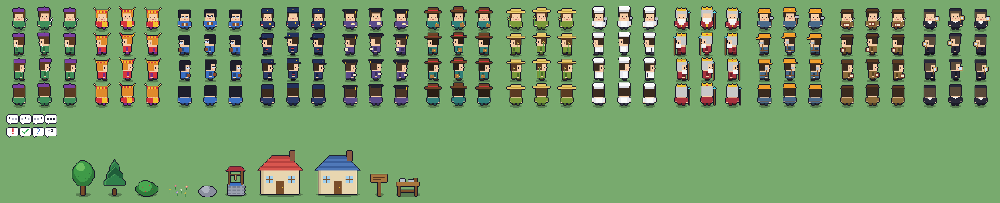

# Multi-Agent Village

像素風的多 agent 村落：每個 agent 是一位村民，村長（orchestrator）依 Agent Card 指派村民合作完成你的問題。

- 村民分工接力、互不相關的工作同時進行；審核員把關；工具型村民用程式精準計算、畫圖
- 跟工匠聊天就能打造新村民；全部在介面上操作，不用寫程式
- 帳號系統：每個人用自己的 LLM 與額度、自己的對話紀錄與長期記憶（書記）
- 看圖：在問答附圖，鑑定師用視覺模型看圖，再交給村長和村民處理（例如收據加總、菜單翻譯）
- 生圖：畫家用 OpenRouter 的生圖模型畫插畫，可以和詩人、鑑定師串接；畫作保存 14 天



## 快速開始

需要：Python 3.12+ 與 [uv](https://docs.astral.sh/uv/)、Node 20+；本地模型可用 [Ollama](https://ollama.com)。

```bash
# 後端
cd backend && uv sync && uv run village serve      # http://127.0.0.1:8000

# 前端（另開終端機）
cd frontend && npm install && npm run dev            # http://localhost:5173
```

1. 打開 http://localhost:5173 ，**第一個註冊的帳號就是管理員**
2. 右上 ⚙️ →「LLM 設定」：新增供應商（Ollama 或雲端）→ 列出模型 → 註冊 → 排好 large / small 分級（每個帳號各自設定）
3. 右下 💬 輸入問題，例如「寫一首關於貓的詩，再改成笑話」，或用 `@poet … → @jester` 直接指名
4. （選用）看圖：在「LLM 設定 → 模型」對能看圖的模型（例如 gpt-4o-mini、gpt-5）做「看圖測驗」，通過後加入 vision 分級，💬 就能附圖
5. （選用）生圖：OpenRouter 供應商按「🎨 列出生圖模型」註冊（例如 `google/gemini-3.1-flash-image`），做「生圖測驗」後加入 image 分級，
   就能請畫家畫圖；張數上限在「村規 → 🎨 畫家」

## 容器部署

```bash
cp .env.example .env     # 填入 FRONTEND_PORT（必填），其餘可用預設
./build.sh               # 只 build image
docker-compose up -d     # 部署 → http://localhost:<FRONTEND_PORT>
```

- 只有前端（nginx）對外開 port，後端只在 compose 內部網路，`/api`、`/ws` 由 nginx 代理
- 前端綁 `0.0.0.0`，本機用 localhost、區網其他機器用主機 IP 都能連
- 容器內連主機 Ollama：`http://host.docker.internal:11434/v1`（已是預設值）
- 資料庫結構由 Alembic 在啟動時自動升級，舊資料保留
- 資料在 volume：`village-data`（DB）、`village-secrets`（主金鑰）。兩者分開，備份 DB 時記得另外妥善保存 secrets；**遺失主金鑰 = 已存的 API key 全部解不開**
- `./build.sh --no-cache` 不使用 build cache

## 安全性

- API key 以 AES-256-GCM 加密存入 DB；主金鑰在 `~/.config/multi-agent-village/master.key`（專案外，權限 600）或環境變數 `VILLAGE_MASTER_KEY(S)`
- API 永遠不回傳明文 key；log 與錯誤訊息自動遮罩
- 帳號：第一位註冊者是管理員（部署後請盡快註冊）；之後註冊是一般成員，管理員可關閉公開註冊。session 是 httpOnly cookie，密碼 scrypt
- 每個帳號的 LLM 設定、對話、記憶、執行紀錄互相隔離；別人的問答在村子裡只看得到動畫，看不到內容
- 忘記密碼：`docker-compose exec backend village reset-password <帳號>`

詳見 [docs/ARCHITECTURE.md](docs/ARCHITECTURE.md)、[docs/ROADMAP.md](docs/ROADMAP.md)。
